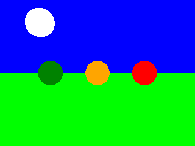

# PlyMOrth Path Tracer

An optimized and advanced path tracer.

## Current progress: 
* primary ray;
* sphere and plane intersection;
* Light source.
* 
Example:

## Goals
* Secondary ray in random direction;
* Möller — Trumbore algorithm;
* BVH-trees;
* PBR;
* Multithreading;
* SIMD;
* CUDA;
* Vulkan;
* A beginner-friendly deep dive about path tracer with math explanation.
## Project Context
This repository is also a topic for a coursework at my university;
